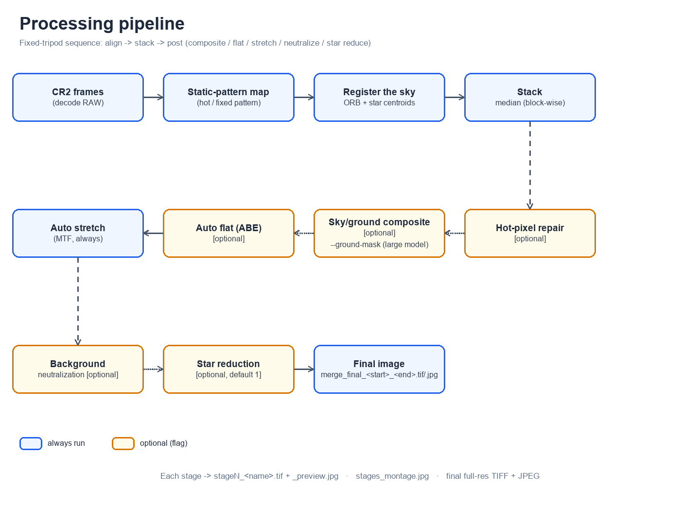

# Star-field Align & Stack

**Languages:** English | [简体中文](docs/README-cn.md)

An **Agent Skill** (with a standalone Python CLI) that **aligns and stacks** a
sequence of Canon **CR2** frames shot from a **fixed tripod** (the sky rotates
between frames while the foreground stays still), then applies a PixInsight-style
post-processing chain — auto flat (ABE), background neutralization, star
reduction — and an optional **sky/ground ("天地") composite** that keeps both the
star field and the foreground sharp.



---

## What it does

| Capability | Description |
| --- | --- |
| **RAW decode** | Reads `IMG_<n>.CR2` with `rawpy` (camera WB, linear, AHD demosaic). |
| **Static-pattern removal** | A two-pass scheme builds a static-pattern map (hot pixels / fixed pattern) from the whole sequence and subtracts it so registration only locks onto real stars. |
| **Sky registration** | ORB feature matching + star-centroid refinement, fitting a similarity transform (rotation + translation + scale) per frame, with plausibility checks (match score, inliers, star residual) that reject bad frames. |
| **Stacking** | Block-wise **median** (recommended) or weighted **mean**; median uses an on-disk memmap so long sequences fit in RAM. |
| **Hot-pixel removal** | Per-channel, single-frame detection of colored hot pixels (isolated local maxima dominated by one channel), with cosmetic repair and before/after figures. `--hot-pre` (per raw frame) or `--hot-post` (stacked). |
| **Sky/ground composite** | Stitches the star-aligned sky onto a static (un-registered) ground layer at the sky/ground boundary. The boundary can be recognised by a **large vision model** (recommended) or detected automatically from temporal variance. |
| **Auto flat (ABE)** | PixInsight `AutomaticBackgroundExtractor`-style 2D polynomial background fit on the **linear** image, subtract/divide, with a blend strength and a strength sweep. |
| **Auto stretch** | Adaptive mid-tone-transfer (MTF) stretch that places the sky background at a target level. |
| **Background neutralization** | Per-channel scaling so the sky background becomes neutral grey (removes light-pollution color casts). |
| **Star reduction** | High-pass star mask + morphological shrink to make nebulae/the Milky Way stand out. |
| **Deliverables** | Every intermediate stage as 16-bit TIFF + preview, a stage montage, and a full-resolution final `merge_final_<start>_<end>.tif/.jpg`. |

---

## Requirements

- Python 3.9+
- [numpy](https://numpy.org/), [opencv-python](https://pypi.org/project/opencv-python/), [rawpy](https://pypi.org/project/rawpy/)

This repository is developed on Windows and expects a virtualenv at `.venv/`.

```bash
python -m venv .venv
./.venv/Scripts/python.exe -m pip install -r requirements.txt \
    -i https://mirrors.aliyun.com/pypi/simple/ --trusted-host mirrors.aliyun.com
```

On macOS/Linux use `./.venv/bin/python` instead of `./.venv/Scripts/python.exe`.

Input frames are **not** stored in the repo; point `--dir` at the folder that
contains `IMG_<n>.CR2`.

---

## Install as a skill

This repository **is an Agent Skill**: `SKILL.md` carries the frontmatter
(`name: astro-image-process-skills` + trigger keywords) and the agent-facing
instructions; `scripts/` is the implementation. Put the repository in a skills
directory, keeping the folder name equal to the skill name:

| Scope | Path |
| --- | --- |
| opencode (global) | `~/.config/opencode/skills/astro-image-process-skills/` |
| opencode (project) | `.opencode/skills/astro-image-process-skills/` |
| Claude Code / compatible | `~/.claude/skills/astro-image-process-skills/` |

```bash
git clone git@github.com:xingxinghuo1000/astro-image-process-skills.git \
    ~/.config/opencode/skills/astro-image-process-skills
```

Alternatively register the folder via `skills.paths` in `opencode.json`
(opencode scans those directories recursively for `**/SKILL.md`):

```json
{
  "$schema": "https://opencode.ai/config.json",
  "skills": { "paths": ["~/src/astro-image-process-skills"] }
}
```

Restart opencode afterwards — skills are loaded at startup.

---

## Use the skill

You do **not** call the script by hand: ask the agent in natural language. The
skill's description advertises the trigger keywords (星野, 星空, 银河, 对齐,
叠加, *star field alignment*, *astro stacking*, *CR2 alignment*), so the agent
loads it when your request matches:

- "Stack this nightscape CR2 sequence: `D:\pic\DCIM-2026\08-shangduhu-2`, frames 5994–6012."
- "把这些星野照片对齐叠加并自动拉伸：`D:\pic\...`，范围 5994–6012。"
- "The sky and the foreground should both be sharp — do a 天地合成."

The agent then reads `SKILL.md`, sets up the `.venv`, runs
`scripts/align_stack.py` with the right flags, and inspects the results (it can
even read `ground_stack_preview.jpg`, recognise the foreground and pass a
`--ground-mask`). You can keep going conversationally — "remove the
light-pollution gradient", "the tree is blurred, fix the composite" — and it will
adjust the flags and re-run.

Prefer driving it by hand? See [Manual CLI usage](#manual-cli-usage).

---

## Manual CLI usage

Run the script directly (useful for scripting or debugging); the arguments are
the same ones the skill uses under the hood.

```bash
./.venv/Scripts/python.exe scripts/align_stack.py \
    --dir "D:\pic\DCIM-2026\08-shangduhu-2" \
    --start 5994 --end 6012 \
    --method median --out out

./.venv/Scripts/python.exe scripts/align_stack.py --help
```

```text
align_stack.py
  --dir DIR                folder containing IMG_<n>.CR2
  --start N --end N        frame-number range (missing numbers are skipped)
  --out DIR                output directory (default: out)
  --ref N                  reference frame (default: middle of the range)
  --method {mean,median}   combiner (default: median; mean is discouraged)
  --exclude 6007,6012      drop specific frames
  --stretch-bg 0.20        target sky-background level after stretch
  --save-frames            also save each aligned full-res frame
  --neutralize             background neutralization (after stretch)
  --star-reduce PX         star shrink in pixels (default 1; 0 disables)

Flat (auto background / ABE)
  --flat                   enable
  --flat-mode {subtract,divide}   (default: subtract)
  --flat-bins 16 --flat-degree 3 --flat-pct 25
  --flat-strength S        0..1 blend (default 1.0; use ~0.3-0.6 if a ring appears)
  --flat-sweep 0.4,0.5,0.6,0.7    render several strengths into flat_compare.jpg

Hot pixels
  --hot-pre / --hot-post   detect+repair per raw frame / on the stacked master
  --hot-sigma 6 --hot-abs 0.02 --hot-ksize 5 --hot-color 2 --hot-neigh 1 --hot-grow 3

Sky/ground composite (天地合成)
  --composite              enable
  --ground-mask PATH       ground mask from a large vision model (white = ground)
  --composite-horizon {mask,line}
  --composite-thresh 0.05 --composite-feather 25
  --ground-dir DIR --ground-start N --ground-end N   ground from another sequence
```

### Defaults and conventions

- `--method median` is the default and is **strongly recommended** for astro
  sequences: a hot pixel is fixed on the sensor while the frame rotates, so a
  mean leaves a colored streak (`value / N`) that no threshold can remove;
  median rejects it as an outlier.
- Frames must be named `IMG_<n>.CR2`; the range is `--start .. --end` and any
  missing number is logged and skipped.
- All products (processed frames, every intermediate stage, final images) go to
  `--out` (default `out/`).

---

## Typical CLI workflows

**1. Straight stack + gentle star reduction (the everyday case)**

```bash
./.venv/Scripts/python.exe scripts/align_stack.py \
    --dir "D:\pic\DCIM-2026\08-shangduhu-2" --method median --out out
```

**2. Remove a light-pollution gradient and a color cast**

```bash
./.venv/Scripts/python.exe scripts/align_stack.py \
    --dir "D:\pic\DCIM-2026\08-shangduhu-2" --method median \
    --flat --flat-strength 0.5 --neutralize --out out
```

Check `out/flat_compare.jpg` to decide whether to keep the flat, and tune
`--flat-strength` (a full correction of a Milky-Way-filled field can leave a
bright border ring; `~0.5` usually removes it).

**3. Sharpen both the sky and a static foreground (sky/ground composite)**

1. Run once with `--composite` (or use a previous run) to get
   `out/ground_stack_preview.jpg`.
2. Let a large vision model look at that preview and mark the **ground /
   foreground** (tree, building, terrain, horizon) as a grayscale mask PNG where
   **white = ground, black = sky** — e.g. `out/ground_mask.png`.
3. Re-run with the mask:

```bash
./.venv/Scripts/python.exe scripts/align_stack.py \
    --dir "D:\pic\DCIM-2026\08-shangduhu-2" --method median \
    --composite --ground-mask out/ground_mask.png --out out
```

Inspect `out/sky_ground_overlay.jpg` — the boundary is drawn in cyan; the tree
should be outlined tightly and the sky should be free of star trails.

> The composite needs a **fixed tripod** and a **static foreground**, otherwise
> the un-registered "ground" stack is not sharp. If you have a separate set of
> foreground frames, point `--ground-dir` at them.

**4. Colored hot-pixel streaks**

```bash
./.venv/Scripts/python.exe scripts/align_stack.py \
    --dir "D:\pic\..." --method median --hot-post --out out
```

Prefer `--method median` first; add `--hot-post` for residual colored dots near
the rotation centre, or `--hot-pre` to clean every raw frame at the source
(slower). Compare `out/hot_compare_post.jpg`.

**5. Foreground from a dedicated sequence**

```bash
./.venv/Scripts/python.exe scripts/align_stack.py \
    --dir "D:\pic\...\sky" --method median --composite \
    --ground-dir "D:\pic\...\ground" --ground-start 7001 --ground-end 7020 \
    --out out
```

---

## Processing pipeline

The order below is the actual sequence run by `scripts/astro/pipeline.py`.
Optional steps are added to the stage list only when their flag is set, and the
`stageN` numbering follows that order.

1. **Decode + static-pattern map** — half-resolution grayscale previews are
   decoded for every frame; a high percentile across frames isolates the static
   pattern (hot pixels / fixed pattern), which is subtracted before registration.
2. **Register** — ORB features on the enhanced previews, then a star-centroid
   refinement; the result is a similarity transform per frame. Implausible fits
   (low score / inliers or high star residual) are rejected; the frame is skipped.
   With `--hot-pre`, each full-resolution frame is repaired here, before stacking.
3. **Stack** — sky-aligned frames are combined with a **block-wise median**
   (memmap-backed) or a weighted mean → `stage1_stacked`.
4. **Hot-pixel repair** (`--hot-post`) — per-channel detection on the stacked
   master and cosmetic repair → `stage2_hotfix`.
5. **Sky/ground composite** (`--composite`) — build a static ground layer (the
   un-registered average), get the sky/ground boundary (large-model `--ground-mask`
   or temporal-variance detection), and blend the two layers with a feathered
   mask → `stageN_composite`. This becomes the linear master for later steps.
6. **Auto flat / ABE** (`--flat`) — fit a smooth per-channel 2D background on the
   **linear** image and subtract/divide it, blended by `--flat-strength` →
   `stageN_flat`. Writes `flat_compare.jpg` for a visual decision.
7. **Auto stretch** (always) — adaptive MTF stretch to the target background
   level → `stageN_stretched`.
8. **Background neutralization** (`--neutralize`) — per-channel scaling to a
   neutral sky background → `stageN_neutralized`.
9. **Star reduction** (`--star-reduce`, default `1`) — morphology shrink under a
   high-pass star mask → `stageN_star_reduced`.
10. **Deliverables** — every stage is written as `stageN_<name>.tif` +
    `_preview.jpg` and tiled into `stages_montage.jpg`; the finished image is
    written full-resolution as `merge_final_<start>_<end>.tif` and `.jpg`.

---

## Output files

| File | Meaning |
| --- | --- |
| `stageN_<name>.tif` + `_preview.jpg` | Each processing stage (16-bit TIFF + half-size preview); `N` is the stage number. |
| `stages_montage.jpg` | All stages side by side, labelled. |
| `merge_final_<start>_<end>.tif` | **Final image**, 16-bit TIFF at full resolution. `<start>`/`<end>` are the first/last merged frame numbers. |
| `merge_final_<start>_<end>.jpg` | **Final image**, JPEG at full resolution. |
| `stack_<method>.tif` | Linear master after stacking/composite (for external post). |
| `stack_preview.jpg` | Preview of the linear master. |
| `transforms.json` | Per-frame similarity transform, inliers, score. |
| `hot_metrics.json`, `hot_compare_pre.jpg`, `hot_compare_post.jpg` | Hot-pixel audit and before/after figures. |
| `flat_compare.jpg` | No-flat vs flat (and a strength sweep when `--flat-sweep` is used). |
| `ground_stack.tif` + `_preview.jpg` | Static ground layer (with `--composite`). |
| `sky_mask.png`, `sky_ground_overlay.jpg` | Composite mask and inspection overlay (with `--composite`). |
| `star_mask.png` | Star mask (when star reduction runs). |
| `aligned/IMG_<n>.tif` | Each aligned frame (with `--save-frames`). |

---

## Notes & caveats

- **Median first.** Use `--method median` for astro sequences; `mean` is kept
  only for special cases.
- **Flat ring.** A full-strength ABE correction of a Milky-Way-filled field can
  carve the centre and leave a bright border ring — lower `--flat-strength` to
  ~0.3–0.6.
- **Composite requires a static foreground** on a fixed tripod. The ground layer
  comes from the plain (un-registered) average; a moving foreground will smear.
- **Ground-mask polarity.** `--ground-mask` expects a grayscale image where
  **white = ground/foreground** and black = sky. Edges are feathered by
  `--composite-feather`.
- The default `--dir/--start/--end` point at the example sequence; override them
  for your own data.

---

## Project layout

```text
scripts/align_stack.py     command-line front end (argparse only)
scripts/astro/             implementation, one module per step
  util.py imgio.py         logging/array helpers, CR2 decode / TIFF write
  registration.py          ORB + star-centroid similarity registration
  stacking.py              mean / block-wise median accumulation
  hotpixels.py             per-channel hot-pixel detection/repair
  flat.py stretch.py       auto flat (ABE), auto MTF stretch
  neutralize.py            background neutralization
  star_reduce.py           star shrink
  composite.py horizon.py  sky/ground stitch + boundary detection
  render.py                per-stage TIFF/JPEG, montage, comparisons
  pipeline.py              orchestration
docs/                      design notes and diagrams
out/                       default output directory (git-ignored)
```
