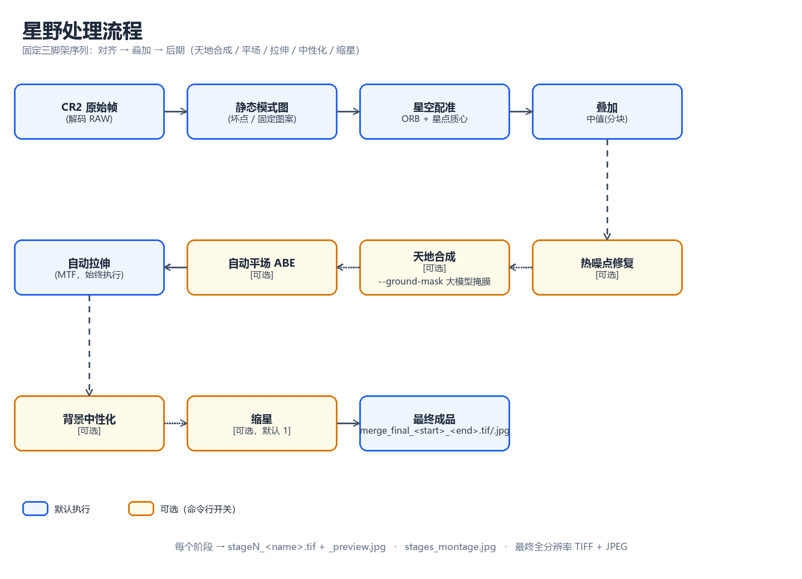

# 星野对齐叠加与后期（Star-field Align & Stack）

**语言：** [English](../README.md) | 简体中文

一个纯 Python 流水线：把**固定三脚架**拍摄的佳能 **CR2** 星野序列（帧间星空在转、地景不动）
做**对齐 + 叠加**，再走一遍 PixInsight 风格的后期链——自动平场（ABE）、背景中性化、缩星，
以及可选的**天地合成**，让星空和前景同时保持锐利。



---

## 功能一览

| 能力 | 说明 |
| --- | --- |
| **RAW 解码** | 用 `rawpy` 读取 `IMG_<n>.CR2`（相机白平衡、线性、AHD 去马赛克）。 |
| **静态模式去除** | 两遍式：先用整段序列构建静态模式图（热噪点 / 固定图案）并扣除，让配准只锁定真实星点。 |
| **星空配准** | ORB 特征匹配 + 星点质心精修，拟合相似变换（旋转 + 平移 + 缩放），并用匹配分、内点数、星点残差做合理性校验，剔除坏帧。 |
| **叠加** | 分块**中值**（推荐）或加权**均值**；中值用磁盘 memmap，长序列也不会爆内存。 |
| **热噪点去除** | 单帧、逐通道检测彩色热噪点（被单一通道支配的孤立局部极大），做"美化式"修复并输出前后对比图。`--hot-pre`（逐原始帧）或 `--hot-post`（叠加后）。 |
| **天地合成** | 在天地分界线处，把「对齐到星空的天景」和「不配准的静态地景层」拼接。分界线可由**大模型识图**给出（推荐），或用时间方差自动检测。 |
| **自动平场（ABE）** | 在**线性图**上做类 PixInsight `AutomaticBackgroundExtractor` 的二维多项式背景拟合，可减可除，带强度混合与多强度对比。 |
| **自动拉伸** | 自适应 MTF 拉伸，把天空背景放到目标亮度。 |
| **背景中性化** | 逐通道缩放，把天空背景校正为中性灰（消除光害导致的偏色）。 |
| **缩星** | 高通星点掩膜 + 形态学收缩，让星云/银河更突出。 |
| **产物** | 每个阶段 16-bit TIFF + 预览、阶段拼接对比图，以及全分辨率最终成品 `merge_final_<start>_<end>.tif/.jpg`。 |

---

## 环境与安装

- Python 3.9+
- [numpy](https://numpy.org/)、[opencv-python](https://pypi.org/project/opencv-python/)、[rawpy](https://pypi.org/project/rawpy/)

本仓库主要在 Windows 上开发，默认使用仓库根目录的 `.venv/`：

```bash
python -m venv .venv
./.venv/Scripts/python.exe -m pip install -r requirements.txt \
    -i https://mirrors.aliyun.com/pypi/simple/ --trusted-host mirrors.aliyun.com
```

macOS/Linux 把 `./.venv/Scripts/python.exe` 换成 `./.venv/bin/python`。

输入帧不放进仓库；用 `--dir` 指向包含 `IMG_<n>.CR2` 的目录。

---

## 快速开始

```bash
./.venv/Scripts/python.exe scripts/align_stack.py \
    --dir "D:\pic\DCIM-2026\08-shangduhu-2" \
    --start 5994 --end 6012 \
    --method median --out out
```

流程会配准、叠加并写出各阶段图像，最终成品是
`out/merge_final_5994_6012.tif` 和 `.jpg`。所有产物都写到 `--out`（默认 `out/`，已被 git 忽略）。

查看全部参数：

```bash
./.venv/Scripts/python.exe scripts/align_stack.py --help
```

---

## 用法

```text
align_stack.py
  --dir DIR                包含 IMG_<n>.CR2 的目录
  --start N --end N        帧号范围（缺失的帧号会跳过）
  --out DIR                输出目录（默认 out）
  --ref N                  参考帧（默认取范围中间帧）
  --method {mean,median}   叠加方式（默认 median；不推荐 mean）
  --exclude 6007,6012      剔除指定帧
  --stretch-bg 0.20        拉伸后的天空背景目标亮度
  --save-frames            另存每帧对齐后的全分辨率 TIFF
  --neutralize             背景中性化（在拉伸之后）
  --star-reduce PX         缩星像素数（默认 1；0 关闭）

平场（自动背景 / ABE）
  --flat                   开启
  --flat-mode {subtract,divide}   （默认 subtract）
  --flat-bins 16 --flat-degree 3 --flat-pct 25
  --flat-strength S        0..1 混合强度（默认 1.0；出现亮环时用 ~0.3–0.6）
  --flat-sweep 0.4,0.5,0.6,0.7    把多个强度平铺进 flat_compare.jpg

热噪点
  --hot-pre / --hot-post   逐原始帧 / 在叠加主图上检测并修复
  --hot-sigma 6 --hot-abs 0.02 --hot-ksize 5 --hot-color 2 --hot-neigh 1 --hot-grow 3

天地合成
  --composite              开启
  --ground-mask PATH       大模型识别的地景掩膜（白 = 地景）
  --composite-horizon {mask,line}
  --composite-thresh 0.05 --composite-feather 25
  --ground-dir DIR --ground-start N --ground-end N   用另一组地景序列
```

### 约定与默认值

- `--method median` 是默认值，且对星野序列**强烈推荐**：热噪点在传感器上固定不动、而画面在旋转，
  均值会留下一条 `值 / N` 的彩色拖线，任何阈值都去不掉；中值把它当离群值剔除。
- 帧文件名必须是 `IMG_<n>.CR2`；范围 `--start .. --end`，缺号会记录并跳过。
- 所有产物（处理帧、每个中间阶段、最终成品）都写到 `--out`（默认 `out/`）。

---

## 典型用法

**1. 直接叠加 + 轻微缩星（日常）**

```bash
./.venv/Scripts/python.exe scripts/align_stack.py \
    --dir "D:\pic\DCIM-2026\08-shangduhu-2" --method median --out out
```

**2. 去除光害梯度与偏色**

```bash
./.venv/Scripts/python.exe scripts/align_stack.py \
    --dir "D:\pic\DCIM-2026\08-shangduhu-2" --method median \
    --flat --flat-strength 0.5 --neutralize --out out
```

先看 `out/flat_compare.jpg` 决定是否保留平场，再微调 `--flat-strength`
（被银河铺满的画面做满强度校正，可能在边缘留下一圈亮环，`~0.5` 通常能消掉）。

**3. 星空与静态前景都锐利（天地合成）**

1. 先用 `--composite` 跑一次（或复用已有结果），得到 `out/ground_stack_preview.jpg`。
2. 让具备视觉能力的大模型看这张预览，把**地景 / 前景**（树、建筑、地形、地平线）标成一张灰度掩膜 PNG，
   **白色 = 地景，黑色 = 天空**，例如 `out/ground_mask.png`。
3. 带着掩膜重跑：

```bash
./.venv/Scripts/python.exe scripts/align_stack.py \
    --dir "D:\pic\DCIM-2026\08-shangduhu-2" --method median \
    --composite --ground-mask out/ground_mask.png --out out
```

看 `out/sky_ground_overlay.jpg` 检查：分界线（青色）应紧贴树冠轮廓，天空里不应出现星轨。

> 天地合成要求**固定三脚架**且**前景静止**，否则"不配准的地景层"本身就会糊。
> 如果有单独拍的地景帧，用 `--ground-dir` 指过去。

**4. 彩色热噪点拖线**

```bash
./.venv/Scripts/python.exe scripts/align_stack.py \
    --dir "D:\pic\..." --method median --hot-post --out out
```

先保证 `--method median`；旋转中心附近残留的彩点再加 `--hot-post`，或从源头用 `--hot-pre`
逐帧清理（更慢）。对比 `out/hot_compare_post.jpg`。

**5. 用单独的地景序列**

```bash
./.venv/Scripts/python.exe scripts/align_stack.py \
    --dir "D:\pic\...\sky" --method median --composite \
    --ground-dir "D:\pic\...\ground" --ground-start 7001 --ground-end 7020 \
    --out out
```

---

## 处理流程

下面是 `scripts/astro/pipeline.py` 实际执行的顺序。可选步骤只有在开关打开时才会加入阶段列表，
`stageN` 的编号就按这个顺序递增。

1. **解码 + 静态模式图** — 解码每帧的半分辨率灰度预览；跨帧取高分位得到静态模式（热噪点 / 固定图案），
   配准前先扣除。
2. **配准** — 在增强预览上跑 ORB，再用星点质心精修，得到每帧的相似变换。不合理的解
   （匹配分/内点低或星点残差大）会被拒绝，该帧跳过。开启 `--hot-pre` 时，在这里对每张全分辨率帧先修热噪点。
3. **叠加** — 对齐后的帧用**分块中值**（memmap）或加权均值合成 → `stage1_stacked`。
4. **热噪点修复**（`--hot-post`）— 在叠加主图上逐通道检测并美化修复 → `stage2_hotfix`。
5. **天地合成**（`--composite`）— 构建静态地景层（不配准的平均），取得天地分界线
   （大模型 `--ground-mask` 或时间方差自动检测），用羽化掩膜融合两层 → `stageN_composite`。
   它成为后续所有步骤所操作的线性主图。
6. **自动平场 / ABE**（`--flat`）— 在**线性图**上拟合平滑的逐通道二维背景并减去/除去，
   按 `--flat-strength` 混合 → `stageN_flat`。同时写 `flat_compare.jpg` 供目视决策。
7. **自动拉伸**（始终）— 自适应 MTF，把背景拉到目标亮度 → `stageN_stretched`。
8. **背景中性化**（`--neutralize`）— 逐通道缩放到中性天空背景 → `stageN_neutralized`。
9. **缩星**（`--star-reduce`，默认 `1`）— 在高通星点掩膜下做形态学收缩 → `stageN_star_reduced`。
10. **产物** — 每个阶段都写成 `stageN_<name>.tif` + `_preview.jpg`，并拼进 `stages_montage.jpg`；
    最终成品以全分辨率写成 `merge_final_<start>_<end>.tif` 和 `.jpg`。

---

## 输出文件

| 文件 | 含义 |
| --- | --- |
| `stageN_<name>.tif` + `_preview.jpg` | 每个处理阶段（16-bit TIFF + 半尺寸预览），`N` 为阶段序号。 |
| `stages_montage.jpg` | 所有阶段并排、带标签的对比图。 |
| `merge_final_<start>_<end>.tif` | **最终成品**，16-bit TIFF，全分辨率。`<start>`/`<end>` 为合并序列的首/末帧号。 |
| `merge_final_<start>_<end>.jpg` | **最终成品**，JPEG，全分辨率。 |
| `stack_<method>.tif` | 叠加/合成后的线性主图（供外部后期）。 |
| `stack_preview.jpg` | 线性主图预览。 |
| `transforms.json` | 每帧的相似变换、内点数、评分。 |
| `hot_metrics.json`、`hot_compare_pre.jpg`、`hot_compare_post.jpg` | 热噪点审计与前后对比图。 |
| `flat_compare.jpg` | 不平场 vs 平场（用 `--flat-sweep` 时还会平铺多个强度）。 |
| `ground_stack.tif` + `_preview.jpg` | 静态地景层（`--composite` 时）。 |
| `sky_mask.png`、`sky_ground_overlay.jpg` | 天地合成掩膜与检查用叠加图（`--composite` 时）。 |
| `star_mask.png` | 星点掩膜（缩星时）。 |
| `aligned/IMG_<n>.tif` | 每帧对齐结果（`--save-frames` 时）。 |

---

## 注意事项

- **优先用中值。** 星野序列用 `--method median`；`mean` 只留给特殊情形。
- **平场亮环。** 对银河铺满的画面做满强度 ABE，可能把中心压暗、边缘留一圈亮环——把
  `--flat-strength` 降到 ~0.3–0.6。
- **天地合成需要静止前景。** 地景层来自不配准的平均，前景在动就会糊。
- **地景掩膜极性。** `--ground-mask` 要求灰度图**白色 = 地景/前景**、黑色 = 天空；
  边缘会按 `--composite-feather` 羽化。
- 默认的 `--dir/--start/--end` 指向示例序列，请替换为你自己的数据。

---

## 项目结构

```text
scripts/align_stack.py     命令行入口（只做 argparse）
scripts/astro/             实现，每个步骤一个模块
  util.py imgio.py         日志/数组助手、CR2 解码 / 写 TIFF
  registration.py          ORB + 星点质心相似配准
  stacking.py              均值 / 分块中值累加
  hotpixels.py             逐通道热噪点检测/修复
  flat.py stretch.py       自动平场（ABE）、自动 MTF 拉伸
  neutralize.py            背景中性化
  star_reduce.py           缩星
  composite.py horizon.py  天地合成 + 分界线检测
  render.py                各阶段 TIFF/JPEG、拼接、对比图
  pipeline.py              编排
docs/                      说明文档与流程图
out/                       默认输出目录（已被 git 忽略）
```
