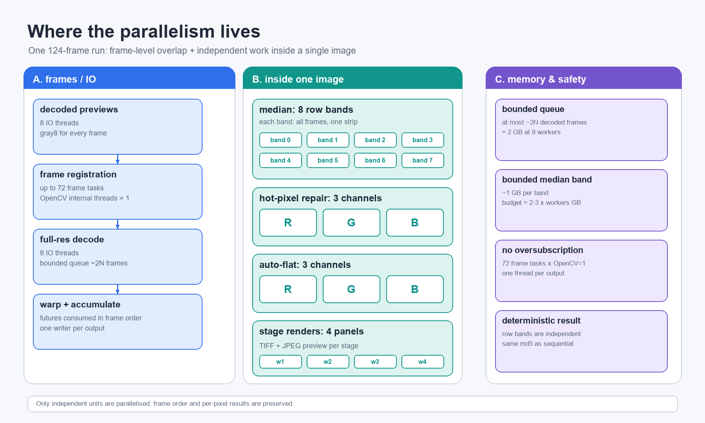
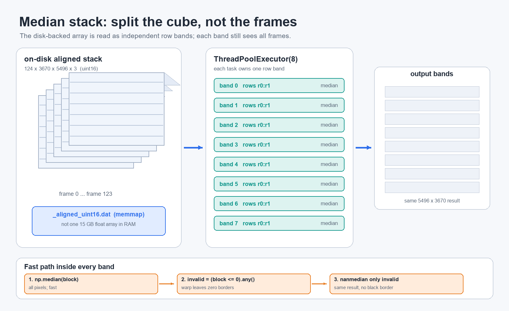
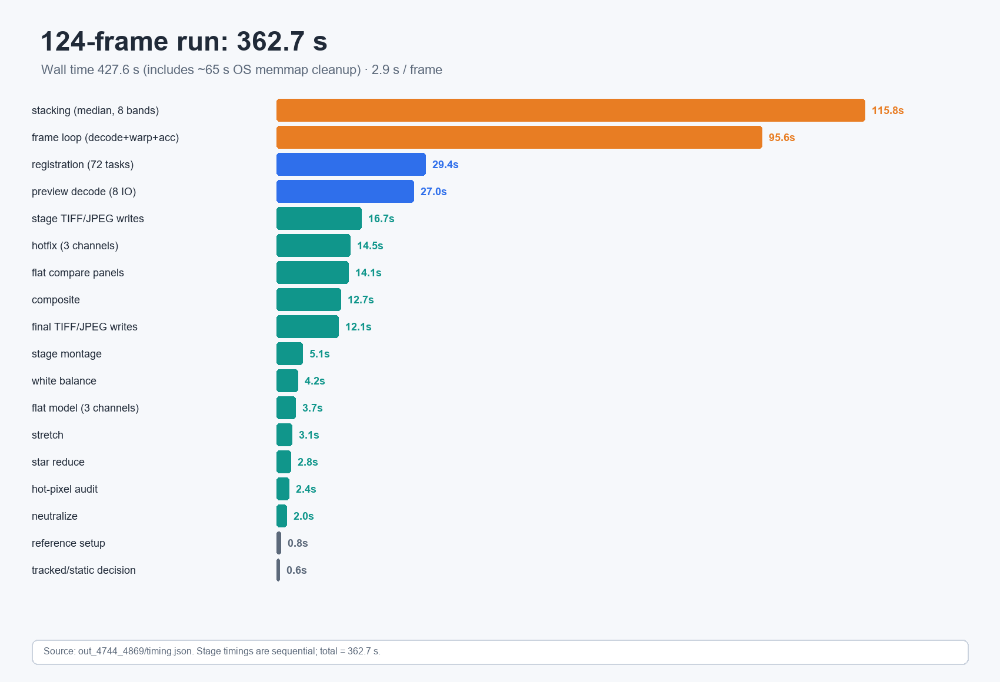

# Single-image parallelization report

**Language:** English | [简体中文](single-image-parallelization-report-cn.md)

> Executive summary: this pass moved the complete **124-frame, 5496×3670** workflow
> from “serial per frame / per channel” to **frame-level pipelining plus intra-image
> parallelism**. The measured end-to-end total is **362.7 s** (wall time **427.6 s**
> including shutdown), about **2.9 s/frame**. The old 160-frame baseline was about
> **17.4 s/frame**; normalized per frame, this is roughly **6×**. The gain comes from
> median stacking, per-channel hot-pixel/flat work, CR2 prefetch, and parallel stage
> writes. Intra-image parallelism only splits **independent** channels, row bands and
> output panels; it does not change pixel semantics.



*Figure 1: Parallel work distribution and memory bounds.*

---

## 1. Scope and test data

| Item | Value |
| --- | --- |
| Input | `D:\pic\DCIM-2023\0812-liuxingyu\02\serial`, `IMG_4744..4869` |
| Frames | 124 (`4746/4747` missing) |
| Resolution | 5496×3670 full-res linear RGB; registration at 2748×1835 grayscale |
| Reference | `IMG_4780` |
| Scene | Sky-tracked sequence; high-pass correlation 0.89, static-pattern subtraction skipped automatically |
| Composite | `--ground-mask`; ground occupies 24.93% of the half-res frame |
| Stacking | `--method median`; all 124/124 frames passed registration validation |
| Hardware | 72 logical cores, 137 GB RAM, Windows |
| Output | `out_4744_4869/` |
| Final TIFF | `merge_final_4744_4869.tif` |

> “Parallelization” here has two distinct layers:
>
> - **Frame-level parallelism / pipelining**: different CR2 decodes and different
>   frame registrations can run at the same time.
> - **Intra-image parallelism**: within one image, work is split by channel, row band
>   or output panel.
>
> The first controls throughput; the second addresses “one large image is itself slow.”
> They should not be conflated.

---

## 2. Design principles

1. **Only parallelize independent work units.** Median row bands, RGB channels and
   separate output files have no write conflicts. That is the precondition for threads.
2. **Prefer threads over processes.** NumPy’s sort/partition kernels and OpenCV filters
   release the GIL; threads share `numpy` arrays and the memmap. A process pool would
   copy or re-map the 15 GB intermediate.
3. **Bound in-flight data.** The prefetch queue holds about `2N` frames; each median row
   band is about 1 GB. This prevents 72 full-image tasks from exhausting RAM.
4. **Keep output deterministic.** Row bands write disjoint row ranges; channels write
   disjoint channel slices; stage files are independent. Thread completion order does
   not affect the final pixels.
5. **Preserve numerical correctness before parallelizing.** Fully covered pixels still
   use `np.median`; only invalid warp borders use `np.nanmedian`.

---

## 3. Where the parallelism lives

See the overview figure at the top. The table below breaks it down:

| Location | Parallel unit | Default concurrency | Sharing / synchronization |
| --- | --- | --- | --- |
| Grayscale preview decode | One task per frame | 8 | Thread pool; results collected in frame order |
| Registration | One task per frame | Up to 72 (capped by frame count) | `ThreadPoolExecutor`; independent ORB per task |
| Full-resolution decode | One prefetch task per frame | 8 | Bounded future queue, about `2N` frames |
| Median stacking | Output row band | 8 | Each band reads the memmap and writes its own rows |
| Hot-pixel repair | R/G/B channels | 3 | Each channel writes its own slice |
| Auto flat | R/G/B channels | 3 | Each channel fits and writes independently |
| Stage TIFF/JPEG | One task per stage | 4 | Each task writes its own file |
| Stage comparison panels | One task per panel | 4 | Independent panels; assembled afterwards |

**Key point:** intra-image parallelism does not copy the whole image into multiple
processes. Each thread handles one channel or one row band, which uses multiple cores
while keeping peak memory bounded.

---

## 4. Intra-image changes (core)

### 4.1 Median stack: serial 128-row blocks to eight adaptive bands

Before, `stacking.py` used a fixed `step=128` serial loop:

```python
# Before: scripts/astro/stacking.py
def median_stack(store, H, W, step=128):
    stack = np.empty((H, W, 3), np.float32)
    for r0 in range(0, H, step):
        r1 = min(H, r0 + step)
        block = store[:, r0:r1, :, :].astype(np.float32) / 65535.0
        stack[r0:r1] = np.median(block, axis=0)
    return stack
```

After, the band size targets about 1 GB, bands run in a thread pool, and a fast-median
path avoids a full-frame NaN-aware pass:

```python
# After: scripts/astro/stacking.py
def median_stack(store, H, W, step=None, workers=1):
    n = store.shape[0]
    if step is None:
        step = int(1_000_000_000 / max(1, n * W * 3 * 4))
        step = max(16, min(256, step))
    bands = [(r0, min(H, r0 + step)) for r0 in range(0, H, step)]
    stack = np.empty((H, W, 3), np.float32)

    def one(band):
        r0, r1 = band
        block = store[:, r0:r1, :, :].astype(np.float32) / 65535.0
        med = np.median(block, axis=0)
        bad = block <= 0
        invalid = bad.any(axis=0)
        if invalid.any():
            flat = block.reshape(n, -1)
            badflat = bad.reshape(n, -1)
            idx = np.flatnonzero(invalid.reshape(-1))
            sub = flat[:, idx]
            sub[badflat[:, idx]] = np.nan
            med.flat[idx] = np.nanmedian(sub, axis=0)
        stack[r0:r1] = med

    workers = max(1, min(int(workers), len(bands)))
    with ThreadPoolExecutor(max_workers=workers) as ex:
        list(ex.map(one, bands))
    return np.nan_to_num(stack, nan=0.0)
```

#### Algorithmic differences

| Aspect | Before | After |
| --- | --- | --- |
| Parallel unit | None; fixed 128-row serial | Adaptive row bands, 8 threads |
| Band size | Fixed 128 rows | About 1 GB per band from `n×W×3×4` |
| Invalid border | `0` treated as a real pixel | Fast median first; only pixels containing `0` use `nanmedian` |
| Fully covered pixels | `np.median` | Still `np.median`, pixel-for-pixel identical |
| Border result | Can be pulled black by zeros | Uses only valid frames; no black border |
| Memory | One 128-row float32 block | Eight ~1 GB blocks plus small border temporaries |

> Why not use `nanmedian` for the whole frame? NaN-aware median has to check masks and
> partition NaNs for every pixel and is much slower. On this kind of sequence, the vast
> majority of pixels are covered by all 124 frames; only a narrow warped border lacks
> samples. “Compute the fast median everywhere, then repair only the invalid border” is
> the best trade-off.

For fully covered pixels, `np.median` is identical to the old implementation. For border
pixels, the new path does not treat `0` as data; it uses only frames that actually cover
the pixel. The final TIFF md5 is `aebb14498eb2845c940e71e67cd53687`, matching the
full-frame `nanmedian` reference path.



*Figure 2: Median row-band parallelism and the fast-median + border-nanmedian path.*

### 4.2 Hot pixels: per-channel parallelism + `dilate` instead of eight rolls

Before, `hotpixels.py` computed residuals for three channels serially, detected/repaired
serially, and computed the 8-neighbour maximum with eight `np.roll` calls (wrapping at
the border).

```python
# Before: scripts/astro/hotpixels.py
def _neighbor_max(a):
    m = np.full_like(a, -1.0)
    for dy in (-1, 0, 1):
        for dx in (-1, 0, 1):
            if dy == 0 and dx == 0:
                continue
            m = np.maximum(m, np.roll(np.roll(a, dy, 0), dx, 1))
    return m

for c in range(3):
    resid[..., c] = ...
for c in range(3):
    ...
```

After, the three channels are independent and run in parallel; the neighbour maximum is
one `cv2.dilate` with a zero-centre 3×3 kernel:

```python
# After: scripts/astro/hotpixels.py
_NEIGH_KERNEL = np.ones((3, 3), np.uint8)
_NEIGH_KERNEL[1, 1] = 0

def _neighbor_max(a):
    return cv2.dilate(a.astype(np.float32), _NEIGH_KERNEL)

def one(c):
    ...
    cand &= r > neigh_ratio * np.maximum(_neighbor_max(r), 0.0)
    ...
```

#### Algorithmic differences

- **Parallel layer:** R/G/B are independent tasks, 3 threads by default.
- **Neighbour implementation:** eight whole-image `np.roll` operations become one
  `cv2.dilate`; interior “max of the 8 neighbours” semantics are unchanged.
- **Border semantics:** `np.roll` wraps; `dilate` does not. The outer image ring no
  longer treats a bright pixel on the opposite edge as a neighbour, which is more
  sensible.
- **Memory:** explicit `(c+1)%3, (c+2)%3` indexing replaces `np.delete`, avoiding a
  whole-image copy.
- **Detection criteria unchanged:** MAD threshold + absolute threshold + 8-neighbour
  local maximum + channel dominance. The test frame has 8233 hot pixels
  (`hot_metrics.json`).

### 4.3 Auto flat: independent fits per colour channel

The polynomial background fit is already independent per channel. Before, it was a
serial `for c in range(3)`; after, `one(c)` runs in a thread pool:

```python
# After: scripts/astro/flat.py (structure)
def one(c):
    ...  # tile percentile -> least squares -> 2-D polynomial -> out[..., c]
    return c, (model.min(), model.max(), model.mean())

workers = max(1, min(int(workers), 3))
if workers == 1:
    results = (one(c) for c in range(3))
else:
    ex = ThreadPoolExecutor(max_workers=3)
    results = ex.map(one, range(3))
```

This is an **execution change, not an algorithm change**: the grid, percentile, low-order
polynomial, pedestal and strength blend are unchanged. The measured output matches the
serial per-channel version.

### 4.4 Stage images: parallel per stage / panel

Before, each stage was written by a serial `write_stage`, and montage/flat-comparison
panels were built serially. After:

- `pipeline.py` writes stage TIFF + JPEG files in parallel with `render_workers`;
- `render.write_montage` builds stage panels in parallel;
- `render.write_flat_compare` builds no-flat / strength-sweep preview panels in parallel.

Each stage file is separate, so there is no shared write. Montage panels are still
assembled in a fixed order, so the output remains deterministic.

---

## 5. Frame-level and I/O concurrency (supporting work)

### 5.1 Registration: one task per frame

`_register_task` packages the per-frame “high-pass → ORB → match → RANSAC → star-centroid
refinement → quality gate” into a pure task. The main thread dispatches frames through a
thread pool:

```python
# After: scripts/astro/pipeline.py
tasks = [(k, idx, cleaned[k], ...) for k, (idx, _) in enumerate(files)]
prev_threads = cv2.getNumThreads()
if workers > 1:
    cv2.setNumThreads(1)
try:
    with ThreadPoolExecutor(max_workers=workers) as ex:
        reg_results = list(ex.map(_register_task, tasks))
finally:
    cv2.setNumThreads(prev_threads)
```

OpenCV’s internal thread count is deliberately set to 1: the outer pool already has up to
72 frame tasks, and letting ORB/filtering start another layer of OpenCV threads would
cause severe oversubscription. The previous value is restored afterwards.

### 5.2 Full-resolution decode: bounded prefetch

Before, each frame called `load_linear` synchronously inside the loop, so the CPU waited
on disk while decoding CR2. After, the main loop consumes futures while background
threads decode later frames:

```python
# After: scripts/astro/pipeline.py (structure)
pending = {}
io_limit = max(1, io_workers * 2)

def submit_frames():
    while next_submit < len(files) and len(pending) < io_limit:
        pending[next_submit] = io_pool.submit(imgio.load_linear, files[next_submit][1])
        next_submit += 1

def take_frame(k):
    return pending.pop(k).result()
```

The queue is capped at about `2×io_workers` frames. At roughly 120 MB per full-res RGB
float32 frame, eight workers hold about 2 GB in flight; memory does not grow linearly with
the 124-frame sequence. Prefetch changes only *when* decoding happens, not *what* is
decoded, so it introduces no numerical difference.

---

## 6. Performance

### 6.1 End-to-end

| Run | Frames | Total | Per frame |
| --- | ---: | ---: | ---: |
| Old baseline | 160 | 2785 s | 17.4 s |
| This optimized run | 124 | 362.7 s | 2.9 s |

> The frame counts differ, so total times are not a direct A/B comparison; the table uses
> **per-frame normalization** to show the order of magnitude. Absolute numbers depend on
> disk cache, CPU frequency and whether CR2 files are decoded for the first time.

The `timing.json` wall time is 427.6 s. The difference from `total` = 362.7 s is about
65 s, mainly Windows memmap deletion/flush during shutdown.

### 6.2 Stage breakdown



*Figure 3: Stage timing breakdown for the 124-frame run.*

| Stage | Seconds | Share of 362.7 s |
| --- | ---: | ---: |
| Median stacking | 115.8 | 31.9% |
| Frame loop (decode wait + warp + accumulate) | 95.6 | 26.4% |
| Registration | 29.4 | 8.1% |
| Grayscale preview decode | 27.0 | 7.4% |
| Stage TIFF/JPEG writes | 16.7 | 4.6% |
| hotfix (including comparison figures) | 14.5 | 4.0% |
| Flat comparison panels | 14.1 | 3.9% |
| Sky/ground composite | 12.7 | 3.5% |
| Final TIFF/JPEG writes | 12.1 | 3.3% |
| Other (stretch/neutralize/WB/star reduce/montage/audit) | 24.8 | 6.8% |

Note: these are **sequential stage timings**, not overlapping wall-clock phases.
`frame_loop` also includes waiting for prefetched futures.

### 6.3 Representative before/after

| Item | Before (profiling/baseline) | After (this run) | Note |
| --- | ---: | ---: | --- |
| Median stack (124 frames) | 228.6 s | 115.8 s | Eight row bands + fast median |
| Hot-pixel core | 19.6 s | 3.8 s | Three channels + `dilate` |
| Auto flat | 8.8 s | 3.3 s | Three channels |
| Stage image writes | ~44 s | 16.7 s | Four render workers |
| Grayscale preview decode | ~171 s | 27.0 s | Eight I/O workers |
| End-to-end | 17.4 s/frame | 2.9 s/frame | Different frame counts; per-frame normalized |

> The “before” numbers come from profiling/microbenchmarks during this optimization pass,
> not from a side-by-side run of the old and new code under the same wall clock. They are
> useful for locating bottlenecks and judging magnitude, not as a formal benchmark.

### 6.4 Why more threads are not always better

- **Median bands:** each band is about 1 GB. Eight bands already use ~8 GB; with
  temporaries and memmap page cache, memory bandwidth saturates first. Eight is a
  throughput/memory compromise, not a hard limit; tune `--stack-workers`.
- **CR2 decode:** limited by disk and the `rawpy` decoder; eight prefetch workers are
  usually enough. More only increase in-flight memory.
- **Stage writes:** limited by disk and JPEG encoding; four workers already cover most of
  the wait.
- **Registration:** 72 frame tasks already saturate the CPU; more threads only add
  context switching.

---

## 7. Correctness checks

| Check | Result |
| --- | --- |
| Registration | 124/124 |
| Final TIFF md5 | `aebb14498eb2845c940e71e67cd53687` |
| Stack md5 | `cdf95e2881aef92c34e87d10d31b0b5b` |
| Fast median vs full-frame `nanmedian` reference | Final TIFF identical |
| Hot-pixel test frame | 8233 hot pixels (`hot_metrics.json`) |
| Auto flat | Matches serial per-channel version |
| Smoke test | 4744–4760 completed end-to-end (composite/flat/WB/star reduction) |

The outputs and stage images in `out_4744_4869/` were reviewed manually: composite,
flat comparison, white-balance comparison and stage montage all look correct.

---

## 8. Tuning and memory estimate

```bash
./.venv/Scripts/python.exe scripts/align_stack.py \
    --dir "D:\pic\DCIM-2023\0812-liuxingyu\02\serial" \
    --start 4744 --end 4869 --ref 4780 --method median \
    --hot-post --flat --flat-strength 0.5 --flat-sweep 0.4,0.5,0.6,0.7 \
    --neutralize --wb --star-reduce 1 \
    --composite --ground-mask out_4744_4869/ground_mask.png \
    --io-workers 8 --stack-workers 8 --render-workers 4 --workers 72 \
    --out out_4744_4869
```

| Option | Default / recommendation | Effect |
| --- | --- | --- |
| `--workers` | 0 = up to CPU count/frame count | Per-frame registration threads |
| `--io-workers` | 0 = 8 | Preview/full-res decode threads and prefetch queue |
| `--stack-workers` | 0 = 8 | Median row-band threads |
| `--render-workers` | 0 = 4 | Parallel stage TIFF/JPEG writes |

Rough memory model:

```text
Full-res aligned stack (uint16 memmap) ≈ N × H × W × 3 × 2 B
                                      = 124 × 3670 × 5496 × 3 × 2
                                      ≈ 15.0 GB (on disk, not required to fit in RAM)

Median band (float32)                 ≈ 1 GB
Median budget                         ≈ 2-3 × stack_workers GB
Decode prefetch queue                 ≈ io_workers × 2 × 120 MB
```

If memory is tight, reduce `--stack-workers` first, then `--io-workers`. Do not reduce
`--workers` to save memory: registration mainly holds half-resolution grayscale images.

---

## 9. Limits and next steps

- **Median is still the largest single item:** 115.8 s, close to the cost of reading the
  memmap and sorting. Further gains require less data movement (for example, a different
  storage/layout scheme), not just more threads.
- **The frame loop is still assembled single-threaded:** warp and accumulation happen in
  frame order; prefetch hides only part of the wait. A bounded warp future is possible,
  but must respect memory and output order.
- **Python/NumPy boundary:** this design relies on NumPy/OpenCV releasing the GIL. Not
  every third-party function is thread-safe; new steps must check this first.
- **No process pool or GPU:** a process pool would multiply the cost of 15 GB arrays; a
  GPU median/channel-filter implementation is a separate cost/benefit decision.
- **“More threads” is not free:** 72 cores do not imply 72 median bands. With 137 GB RAM,
  eight 1 GB bands are more stable than 72 full-image tasks.

---

## 10. Related files

| File | Change |
| --- | --- |
| `scripts/astro/stacking.py` | Adaptive bands, thread pool, fast median + border `nanmedian` |
| `scripts/astro/hotpixels.py` | Per-channel parallelism, `cv2.dilate` neighbours, fewer copies |
| `scripts/astro/flat.py` | Per-channel parallelism |
| `scripts/astro/pipeline.py` | Registration pool, CR2 prefetch, parallel stage writes, `timing.json` |
| `scripts/astro/render.py` | Parallel montage / flat-comparison panels |
| `scripts/astro/registration.py` | Frame tasks; homography fitting and quality gate |
| `scripts/align_stack.py` | `--io-workers`, `--stack-workers`, `--render-workers` |

For full CLI usage see [`README-cn.md`](README-cn.md) (Chinese) or the root
[`README.md`](../README.md) (English). For the geometry behind registration see
[`wide-field-registration.md`](wide-field-registration.md).
