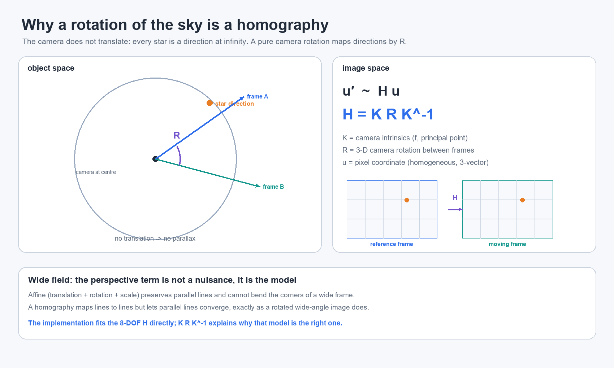
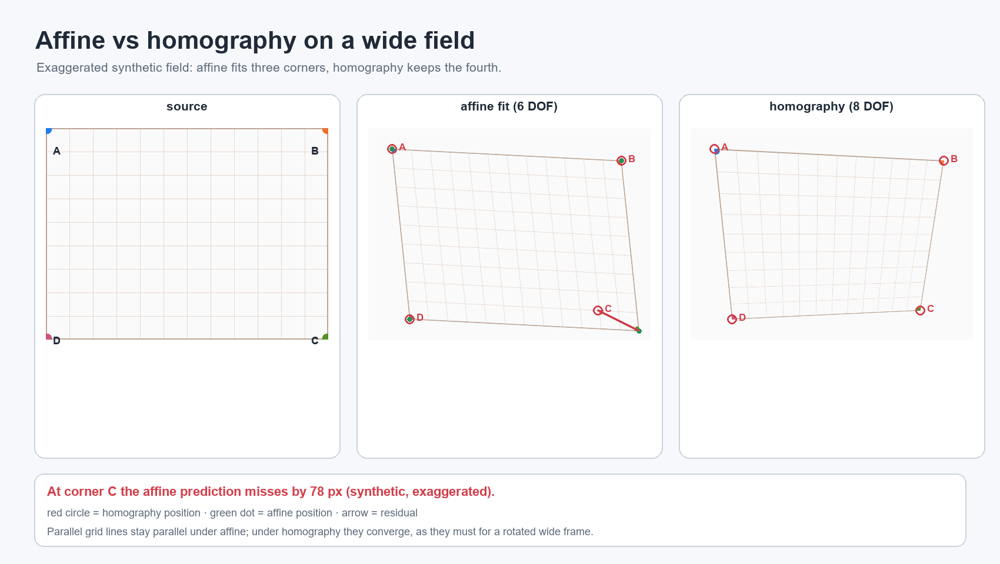
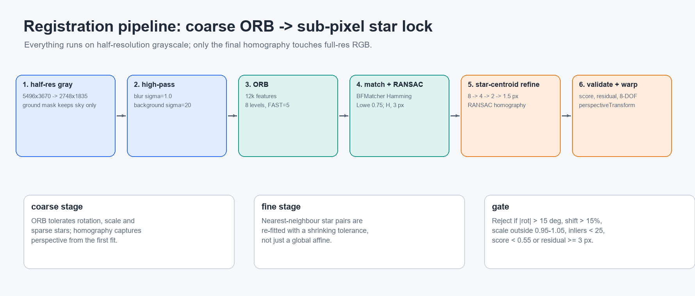

# Wide-field star-field registration: why a homography is enough

**Language:** English | [简体中文](wide-field-registration-cn.md)

> Executive summary: a wide star field aligns not because it is “almost flat,” but
> because **the stars are at infinity and the camera only rotates between frames**.
> Under a pinhole camera, the image motion of a pure rotation is exactly the homography
> `H = K R K^-1`. A wide field simply magnifies the perspective term; the model is still
> an 8-DOF `H`, not something a translation/rotation transform can fully describe.
> Ordinary deep-sky workflows often default to a 4/6-DOF similarity/affine transform,
> which is sufficient for a narrow field but leaves systematic residual at wide-field
> corners. This repository uses coarse ORB registration → star-centroid refinement →
> RANSAC homography → an independent quality gate to make the process robust.



*Figure 1: With stars at infinity and a pure camera rotation, the frame-to-frame map is the homography `H = K R K^-1`.*

---

## 1. The problem: wide field + rotation is not a translation

When a star field is shot from a fixed tripod, the camera does not rotate with the sky.
To the camera, a star is a **direction**, not a fixed point on the sensor:

- Stars are extremely distant, so they can be treated as being at infinity. Small camera
  translations do not create measurable parallax.
- The dominant frame-to-frame motion is a 3-D camera rotation `R`.
- A wide-angle lens covers a large field. Rays near the centre and rays near the corner
  leave the lens in very different directions. The same camera rotation therefore moves
  central and corner pixels by different amounts.

A translation-only fit may lock the centre while the corners trail. A
“translation + rotation + scale” (similarity) fit may be enough for a narrow field, but a
wide field still leaves perspective residual at the corners.

---

## 2. Geometry: why it is a homography

Let the pixel coordinate be the homogeneous vector `u = (x, y, 1)`, and let the camera
intrinsics be `K`:

```text
K = [ f   0   cx ]
    [ 0   f   cy ]
    [ 0   0    1 ]
```

`f` is the focal length in pixels and `(cx, cy)` is the principal point. Back-project the
pixel into normalized camera coordinates:

```text
x = K^-1 u
```

The stars are at infinity, so there is no translational parallax. After the camera rotates
by `R`, the direction of the same star changes from `x` to `R x`:

```text
x' = R x
u' = K x' = K R K^-1 u
```

The pixel mapping between the two frames is therefore:

```text
u' = H u,        H = K R K^-1
```

`H` is a 3×3 homogeneous matrix, arbitrary in scale, with **8 independent degrees of
freedom**. It allows parallel lines in the image to converge, which is exactly the
perspective behaviour of a wide-angle lens. A similarity transform has only 4 DOF and an
affine transform has 6; both are special cases of `H` (their last row is `[0, 0, 1]`), so
they cannot express a denominator that varies across the image.

### 2.1 Why wide field makes it worse

Consider a small camera rotation `Δθ` about an axis perpendicular to the optical axis. A
star at field angle `θ` moves approximately by:

```text
Δp ≈ f · [tan(θ + Δθ) - tan(θ)]
   ≈ f · Δθ · (1 + tan^2(θ)) + ...
```

`1 + tan^2(θ) = sec^2(θ)` grows quickly with field angle. Near the centre (`θ ≈ 0`) the
motion is close to `fΔθ`; at a wide-field corner, the same camera rotation produces a much
larger pixel displacement. A global translation/rotation fit can align the centre while
the corners still drift.

> This is an intuitive example with rotation about an axis perpendicular to the optical
> axis. A real star-field rotation may be about the celestial pole; the homography still
> holds. The key assumptions are **pure rotation + pinhole projection**, not a particular
> rotation axis.

---

## 3. How far off is affine/similarity on a wide field?



*Figure 2: In an exaggerated synthetic case, affine leaves a residual at the fourth corner; the homography locks all four.*

The figure above is a deliberately **exaggerated** synthetic example that magnifies the
difference:

- Left: a source grid with four corners A/B/C/D.
- Middle: a 6-DOF affine fit from three corners. Those three corners land correctly, but
  the fourth corner C still misses; grid lines remain parallel.
- Right: an 8-DOF homography. All four corners land correctly; grid lines may converge.

On a real narrow-field deep-sky image this residual is usually below 1 px, which is why
4/6-DOF models work well. With a wide field, long exposure or large rotation, the residual
starts at the corners and becomes visible trailing. Adding more “translation/rotation”
parameters does not help; the missing ingredient is **perspective**.

---

## 4. Differences from ordinary deep-sky alignment

A clarification: ordinary deep-sky software is not incapable of homographies. Tools such
as PixInsight StarAlignment also support distortion correction/local models. The
comparison here is against the **most common default path** — narrow field, equatorial
tracking, similarity/affine star alignment.

| Dimension | Typical deep-sky default | This wide-field workflow |
| --- | --- | --- |
| Capture | Equatorial tracking, long focal length/narrow field | Fixed tripod or tracked, wide angle |
| Frame motion | Stars barely move; dither gives small translations | Pure camera rotation; corner displacement differs |
| Transform | Translation + rotation + scale (4 DOF), sometimes affine (6 DOF) | Homography (8 DOF), `H = K R K^-1` |
| Perspective | Negligible at narrow field | Must be retained or corners trail |
| Features | Star patterns/catalogues/plate solving common | Multi-scale ORB + star centroids |
| Lens distortion | Small at narrow field; some tools correct it | Homography has no distortion; residual gate, pre-correct if needed |
| Foreground | Usually no ground, or align the whole frame | Ground mask; register the sky only |
| Bad-frame handling | Star count/residual thresholds | Inliers, star score, residual fraction, scale/shift gates |
| Stacking | Sigma clipping, drizzle, etc. | Mean or median, memmap blocks |

### 4.1 Model order

| Model | DOF | Can express | Typical use |
| --- | ---: | --- | --- |
| Translation | 2 | Global shift | Very short focal length, tiny field, quick preview |
| Similarity (shift+rotation+scale) | 4 | Rotation, scale, translation | Ordinary narrow-field deep sky |
| Affine | 6 | Non-uniform scale, shear | Narrow field + slight distortion |
| Homography | 8 | Perspective, converging parallels | Wide field / strong perspective, pure rotation |

This repository does not estimate `K` and `R` and multiply them. It fits the 8-DOF `H`
directly with `cv2.findHomography`. The `K R K^-1` expression explains *why the model is
physically correct*; it does not require camera calibration.

### 4.2 Features and robustness

Ordinary deep-sky workflows often use “find stars → triangle/quad matching → similarity
transform,” because stars are dense, the field is narrow and the initial rotation is
small. Wide-field star fields are harder:

- stars are sparser and smaller, and corners may have coma/astigmatism;
- ground texture can be mistaken for stars;
- initial rotation/perspective may be significant;
- wide-angle lens distortion leaves residual even after a global `H`.

This repository addresses those points with:

1. **Half-resolution grayscale + high-pass:** suppress background and fixed pattern, making
   stars local features.
2. **Multi-scale ORB:** tolerant of rotation and scale; produces a coarse `H`.
3. **Ground mask:** registration only sees sky features, so trees/buildings cannot pollute
   the match.
4. **Star-centroid refinement:** ORB only gets “roughly aligned”; connected-component star
   centroids are nearest-neighbour matched and re-fitted with RANSAC to sub-pixel accuracy.
5. **Independent validation:** high-pass correlation, star residual, inlier count and
   scale/shift gates decide acceptance — not merely “RANSAC returned a matrix.”

---

## 5. The actual pipeline



*Figure 3: From coarse ORB registration to star-centroid refinement.*

The implementation lives in `scripts/astro/registration.py`; orchestration is
`_register_task` in `scripts/astro/pipeline.py:34`.

### 5.1 Preprocessing

- The full-resolution 5496×3670 frame is converted to half-resolution grayscale
  2748×1835; registration runs only at this scale.
- Fixed-tripod sequence: a high percentile across frames builds a static-pattern map (hot
  pixels/fixed pattern), subtracted before registration.
- Tracked sequence: high-pass correlation is high (0.89 in this run), so static-pattern
  subtraction is skipped; otherwise the percentile map would erase the static stars too.
- With `--ground-mask`, the sky region is eroded into a registration mask; in this run the
  sky occupies 75.0% of the half-resolution frame.

### 5.2 Coarse ORB registration

`registration.py:42`:

```python
cv2.ORB_create(nfeatures=12000, scaleFactor=1.2, nlevels=8,
               fastThreshold=5, edgeThreshold=19)
```

Matching uses Hamming distance + Lowe’s ratio test:

```python
bf = cv2.BFMatcher(cv2.NORM_HAMMING)
knn = bf.knnMatch(mob_desc, ref_desc, k=2)
good = [m for m, n in (p for p in knn if len(p) == 2)
        if m.distance < 0.75 * n.distance]
```

A RANSAC homography is then fitted with an initial 3 px reprojection threshold:

```python
M, inl = cv2.findHomography(src, dst, method=cv2.RANSAC,
                            ransacReprojThreshold=3.0,
                            maxIters=20000, confidence=0.999)
```

This is only a “coarse” transform: ORB keypoint positions are quantized and wide-field
corners are especially noisy, so it is not accurate enough to stack directly.

### 5.3 Star-centroid refinement

`refine_transform` at `registration.py:88` performs four rounds of “nearest neighbour +
RANSAC homography” with a shrinking tolerance:

```python
for tol in (8.0, 4.0, 2.0, 1.5):
    m2 = cv2.perspectiveTransform(mov_stars, M)
    # find each m2's nearest neighbour in ref_stars
    keep = dist < tol
    Mn, _ = cv2.findHomography(src[keep], dst[keep],
                               cv2.RANSAC, ransacReprojThreshold=tol,
                               maxIters=20000, confidence=0.999)
    if Mn is not None:
        M = Mn
```

Note that this also uses `perspectiveTransform` / `findHomography`, not
`estimateAffinePartial2D`. Star centroids come from connected components on the high-pass
image; `minarea >= 3` rejects isolated single-pixel hot pixels.

### 5.4 Quality gate

`transform_is_plausible` at `registration.py:140` is the final gate:

| Condition | Threshold | Purpose |
| --- | --- | --- |
| Central rotation | `|rot| < 15°` | Reject obviously wrong/over-rotated solutions |
| Central shift | `< 15%` of width/height | Reject mismatches |
| Local scale | `0.95..1.05` | The lens should not zoom between frames |
| Determinant | `det > 0` | Reject mirror/degenerate solutions |
| Inliers | `>= 25` | Enough star support |
| High-pass correlation | `>= 0.55` | The star field really overlaps after warping |
| Median star residual | `< 3 px` | Coarse sub-pixel lock |
| Fraction within 1.5 px | `>= 0.20` | Reject “only a few stars matched” |

After validation, the half-resolution `M` is converted to full resolution by
`scale_matrix`:

```python
S = np.diag([s, s, 1.0])
M_full = S @ M_half @ np.linalg.inv(S)
```

Finally, `warpPerspective` maps the full-resolution linear RGB frame into the reference
frame.

---

## 6. Results on this real sequence

All 124 frames in `out_4744_4869/` passed:

| Metric | Value |
| --- | --- |
| Registration | 124/124 |
| Reference | `IMG_4780` |
| Tracking detection | High-pass correlation 0.89; tracked, static subtraction disabled |
| Reference ORB / stars | 12000 / 2533 |
| Inliers (excluding reference) | Median 1802, min 1477, max 3737 |
| Star correlation score | Median 0.965, minimum 0.959 |
| Central rotation range | −0.077° … +0.061° |
| Maximum central shift | 5.36 px (full resolution) |
| Sky registration mask | 75.0% of the half-resolution frame |

> This sequence was **sky-tracked**, so frame-to-frame motion was small and the rotation
> range looks modest. It validates the full chain on a wide lens, real stars and a
> sky/ground mask. A fixed-tripod wide-field sequence has a larger `R`, making the
> perspective term more important, but the algorithm and gate are the same. Do not read
> “only 0.08° of rotation” as “wide field only needs translation.”

Inspect per-frame transforms:

```bash
./.venv/Scripts/python.exe - <<'PY'
import json, numpy as np
f = json.load(open("out_4744_4869/transforms.json"))["frames"]
g = [x for x in f if x["frame"] != 4780]
for k in ("rot_deg", "tx", "ty", "inliers", "score"):
    a = np.array([x[k] for x in g])
    print(k, "min", a.min(), "max", a.max(), "median", np.median(a))
PY
```

---

## 7. Why this method aligns a wide field

In order of importance:

1. **The physical model is right:** stars are at infinity and the frame-to-frame motion is
   a pure rotation; under a pinhole camera, pure rotation is the homography
   `H = K R K^-1`, not a translation/similarity.
2. **Eight DOF are enough:** the main wide-field problem is perspective, not “not enough
   stars.” The perspective terms absorb the non-uniform corner displacement.
3. **Coarse-to-fine:** ORB supplies a global initial estimate; star centroids then reduce
   corner error to sub-pixel. Neither ORB alone nor a three-star fit is robust enough.
4. **The ground is excluded:** foreground is at finite distance and has parallax, so it
   cannot share the sky’s `H`. The mask removes it; sky and ground are composited later.
5. **Acceptance is independent:** a RANSAC solution is not automatically correct; inliers,
   star correlation and residual must all pass. A bad frame is skipped rather than allowed
   to smear the stack.
6. **Wide fields still overlap:** short-exposure star frames share many stars between
   frames, giving ORB and centroid matching enough common features to work.

---

## 8. Limits and edge cases

A homography is not a universal solution. These cases need extra handling:

| Situation | What happens | Current handling / recommendation |
| --- | --- | --- |
| Strong barrel/pincushion distortion | Radial residual remains after global `H`; corner stars elongate | Undistort first, or extend to a distortion model/local TPS |
| Moving foreground | Ground violates “infinity + pure rotation” | `--ground-mask`; sky/ground composite |
| Rotation above 15° | Current gate rejects the frame | Re-reference/group registration, or relax the gate with manual review |
| Clouds/sparse stars | ORB/centroid matching fails | Reject the frame; shoot longer/higher ISO if needed |
| Star trailing | ORB and centroids both become biased | Discard trailed frames; keep fixed-tripod exposures short |
| Atmospheric refraction/dispersion | Small positional/colour shifts | Usually sub-pixel; low-altitude targets need special modelling |
| Pure tripod translation | `H` may still fit, but foreground parallax is stronger | Sky/ground composite; keep ground out of sky registration |

In particular: a homography describes a mapping on a **plane / at infinity**. The star
field can be approximated as a plane at infinity; the ground cannot. The correct target of
wide-field star registration is therefore the sky, with the ground handled separately.
That is why `--ground-mask` sits in the registration and compositing chain in this
repository.

---

## 9. Code and related docs

| File | Purpose |
| --- | --- |
| `scripts/astro/registration.py` | ORB, RANSAC homography, star-centroid refinement, quality gate |
| `scripts/astro/pipeline.py` | Half-res preprocessing, tracking detection, per-frame tasks, full-res warp |
| `scripts/astro/stacking.py` | Mean/median stacking of aligned frames |
| `scripts/astro/composite.py` | Sky/ground layer compositing |
| `docs/single-image-parallelization-report.md` | Registration/stacking performance and parallelization |
| `docs/README-cn.md` | Full CLI and workflow guide (Chinese) |
| `README.md` | Full CLI and workflow guide (English) |

One-sentence summary: **wide-field alignment works because “stars at infinity + pure
camera rotation” turns the problem into a homography; ORB, star centroids, RANSAC, a
ground mask and an independent gate make that geometry reliable in practice.**
